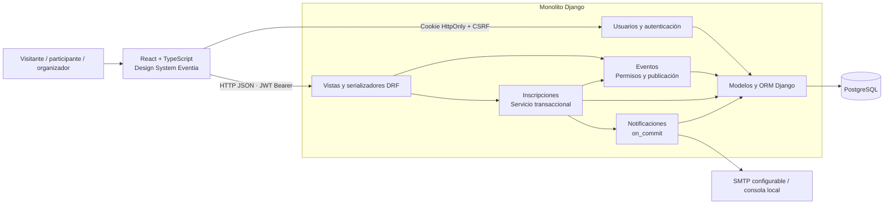

# 02 · Arquitectura inicial

Monolito modular por capas: presentación HTTP (vistas/serializadores), aplicación (servicio de inscripción y envío), dominio/persistencia (modelos y restricciones del ORM). Las operaciones simples permanecen en sus vistas; no se añadieron repositorios o interfaces sin necesidad.

Tecnologías: Python 3.13, Django 5.2, Django REST Framework 3.16, Simple JWT 5.5, psycopg 3, PostgreSQL 18; React 19, TypeScript 5.9, Vite 7 y React Router 7. Las versiones reproducibles están en `backend/requirements.lock.txt` y `frontend/package-lock.json`.

El backend es un solo sistema desplegable; el frontend produce archivos estáticos. En desarrollo, Vite actúa como proxy de `/api`, `/admin` y `/static`; el navegador mantiene un origen para la autenticación. No se incluyó configuración de despliegue externo.

Persistencia normalizada: `users.User` (correo único sin distinguir mayúsculas), `events.Event` (organizador protegido, estado, fecha e índices), `registrations.Registration` (usuario/evento únicos) y `notifications.Confirmation` (una por inscripción). Capacidad positiva protegida también por `CHECK`. Las migraciones están versionadas en cada módulo.

La disponibilidad se deriva de capacidad menos inscripciones confirmadas; no existe un contador redundante que pueda desincronizarse. Las consultas de eventos agregan el conteo y anotan la inscripción del usuario; los listados de inscripciones precargan las relaciones y consultan los eventos en lote. La paginación mantiene un orden explícito por fecha e identificador.

No se añadieron microservicios, colas distribuidas, Kubernetes ni otra base de datos.
