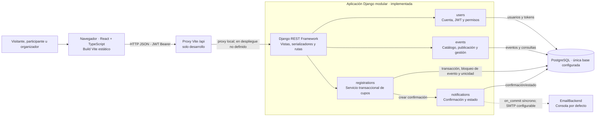
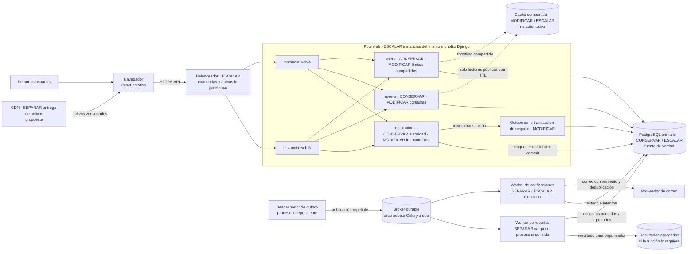

# 04 · Diagramas arquitectónicos

Los bloques Mermaid son la fuente editable. El primer diagrama refleja código y configuración de Fase 1; el segundo es una propuesta, no infraestructura existente. No se exportó SVG/PNG porque no se encontró un renderizador Mermaid local disponible (`mmdc` no está instalado).

## Diagrama A — Arquitectura real de Fase 1

La aplicación React es cliente del API; Vite proxy está configurado para desarrollo, mientras la publicación productiva de los activos no se definió. `on_commit` retrasa el envío hasta confirmar la transacción, pero el callback ejecuta sincrónicamente en el proceso web. Correo por consola es el backend predeterminado; SMTP es una configuración opcional, no una entrega externa verificada. No existen balanceador, caché distribuida, broker, workers, réplica o CDN configurados en Fase 1.

## Diagrama B — Arquitectura recomendada a cinco años

En el dibujo, el broker puede omitirse si un despachador/worker durable basado en PostgreSQL satisface el volumen y la operación; se seleccionaría una sola alternativa tras medir. Los workers pueden usar el mismo repositorio y reglas de negocio: separar su ejecución no crea por sí solo microservicios. El nodo de resultados agregados solo se incorpora para una necesidad comprobada de reportes. No representa una base adicional para cupos.

## Leyenda de evolución

| Marca | Aplicación a Eventia |
|---|---|
| **CONSERVAR** | Módulos de usuarios, eventos e inscripciones; API y modelo relacional; integridad transaccional del cupo. |
| **MODIFICAR** | Outbox y reintentos; límites de solicitud compartidos; telemetría, recuperación y ajustes de consultas/conexiones. |
| **SEPARAR** | Correo y reportes como pools de proceso/worker; CDN como distribución estática. Esto no implica extraer dominios a microservicios. |
| **ESCALAR** | Réplicas de proceso web y, según demanda, capacidad PostgreSQL, workers y caché. Las cantidades se definen con mediciones. |

Los dos diagramas se escribieron con sintaxis Mermaid estándar de `flowchart`. La herramienta local de renderizado/parser no está instalada, por lo que no se afirma una validación automatizada ni se generaron imágenes. La revisión de cercas, etiquetas y flujos se efectuó junto con la verificación documental.
